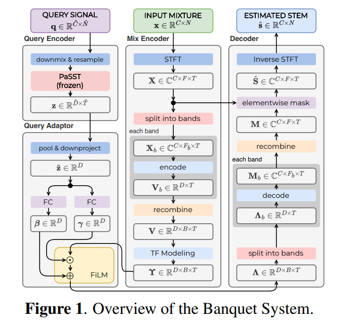

# Music Stem Separator

## 1. Problem

- Separate music to multiple tracks (more than just 4: drums, bass, vocal, others)
- Others is harder to split, say guitar, piano may have the same frequency, same timbre.

## 2. Ref Papers

- A Stem-Agnostic Single-Decoder System for Music Source Separation Beyond Four Stems: https://arxiv.org/pdf/2406.18747 (github: https://github.com/kwatcharasupat/query-bandit)
- Efficient Training of Audio Transformers with Patchout: https://arxiv.org/pdf/2110.05069


## 3. Architecture

### 3.1. Archi



- **PaSST**: listens to ref recording and recognises instrument.
- **FiLM** (Feature-wise Linear Modulation): instructs the separator which characteristics to emphasise.

$$
h' = \gamma(q) \odot h + \beta(q)
$$

### 3.2. Configs

| Component | Config |
|-----------|-------:|
| Input channels        | 2                 |
| Frequency bands       | 64                |
| Embedding dimension   | 128               |
| FiLM depth            | 2                 |
| SQM modules           | 8                 |
| RNN                   | Bidirectional GRU |
| GRU hidden dimension  | 256               |
| MLP dimension         | 512               |
| STFT FFT size         | 2048              |
| STFT hop length       | 512               |
| Complex mask          | Enabled           |
| Sample rate           | 44100 Hz          |

## 4. Implementation

```text
banquet-reimplementation/
│
├── configs/
│   └── banquet.yaml
│
├── src/
│   └── banquet/
│       ├── audio.py
│       ├── stft.py
│       ├── bandsplit.py
│       ├── query_encoder.py
│       ├── film.py
│       ├── separator.py
│       ├── mask.py
│       ├── model.py
│       └── checkpoint.py
│
├── tests/
│   ├── test_stft.py
│   ├── test_bandsplit.py
│   ├── test_film.py
│   ├── test_separator.py
│   └── test_checkpoint.py
│
├── experiments/
│
└── scripts/
    └── separate.py
```

Mixture audio
[B, 2, T]

STFT + musical band splitting
Frequency representation divided into 64 bands

Query encoder
Reference instrument audio → query embedding
+
Separator
Band features → temporal modelling

FiLM conditioning
Query embedding controls mixture representation

Complex mask estimation
Estimate target source in the frequency domain

Inverse STFT
Separated audio waveform

- `bandsplit.py`: Divide frequency bins into musical bands
- `query_encoder.py`: Encode reference audio
- `film.py`: Condition mixture features on query
- `separator.py`: Model relationships across time and bands
- `mask.py`: Estimate complex-valued masks
- `model.py`: Connect the components
- `checkpoint.py`: Load pretrained parameters